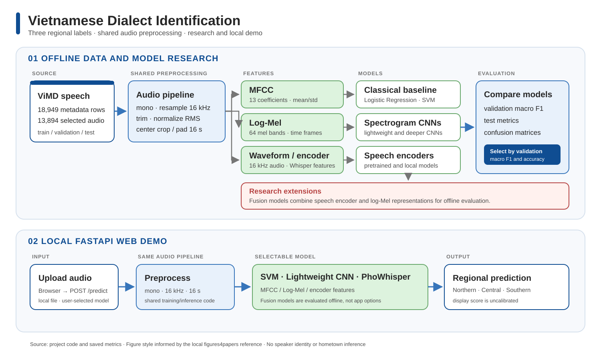
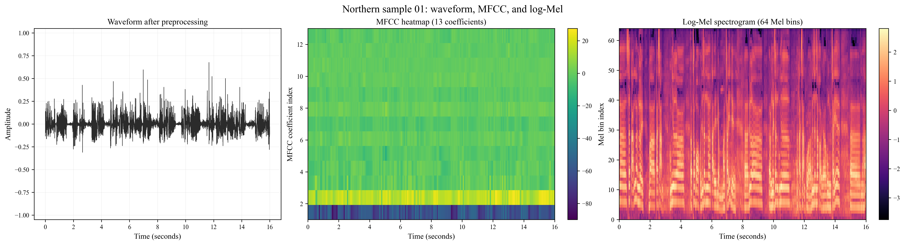

# Vietnamese Dialect Identification

A Python project for classifying Vietnamese speech into three broad regional labels: **Northern**, **Central**, and **Southern**. It provides a reproducible audio pipeline, several classification approaches, evaluation tools, and a local web app where users can upload a recording and view a prediction.

## What the project includes

- Preparation of the [ViMD](https://huggingface.co/datasets/nguyendv02/ViMD_Dataset) speech dataset
- One preprocessing path shared by training and inference
- MFCC baselines and neural audio classifiers
- A FastAPI app with a simple upload interface
- Scripts, tests, and saved figures for working with the project

## System overview

The project has two connected workflows. Offline, audio is prepared and used to train and evaluate models. In the web app, an uploaded recording passes through the same preprocessing code before the selected model makes a prediction.



Audio is converted to mono, resampled to 16 kHz, trimmed and normalized, then cropped or padded to 16 seconds. Depending on the model, the pipeline uses MFCC features, a log-Mel spectrogram, or features from a speech encoder.

The image below shows one example of the waveform and two feature representations produced from it.



## Requirements

- Python 3.10 or newer
- Storage for the downloaded speech data and generated model files
- A PyTorch installation compatible with your CPU or accelerator

## Getting started

Run these commands from the repository root.

### 1. Install dependencies

```bash
python3.10 -m venv .venv
.venv/bin/python -m pip install -r requirements.txt
```

### 2. Prepare data and train models

```bash
scripts/data.sh --overwrite
scripts/train.sh --device auto --overwrite
```

The data script downloads a local subset of ViMD and creates fixed-length audio files. The training script builds the main baselines and model files. Both commands can take time and use significant storage. The `--overwrite` option replaces existing generated results. Run either script with `--help` for its options.

If you already have compatible local model files, you can skip training and start the app directly.

### 3. Run the web app

```bash
.venv/bin/python -m uvicorn src.app.main:app --reload
```

Open <http://127.0.0.1:8000/>. Upload an audio file, choose an available model, and select **Predict**. The app offers SVM, a lightweight CNN, and PhoWhisper when their local model files are present. The default option is the lightweight CNN.

## API

The app provides these endpoints:

| Endpoint | Purpose |
| --- | --- |
| `GET /health` | Check the app and model availability |
| `GET /models` | List selectable models |
| `POST /predict` | Upload audio and request a prediction |

Example request:

```bash
curl -F "file=@sample.wav" -F "model=cnn" http://127.0.0.1:8000/predict
```

The response includes the predicted label, display scores for the three labels, and the device used for inference. The score values are not calibrated probabilities.

## Repository layout

| Path | Contents |
| --- | --- |
| `src/data/` and `src/utils/` | Dataset preparation and shared audio processing |
| `src/features/` and `src/models/` | Feature extraction and model definitions |
| `src/training/` and `src/evaluation/` | Training and evaluation code |
| `src/inference/` and `src/app/` | Prediction code and web app |
| `scripts/` | Commands for the data and training workflows |
| `configs/` | Label mapping and model settings |
| `tests/` | Automated tests |
| `outputs/figures/` | System and audio visualization figures |

Dataset metadata and selected evaluation artifacts are included in Git. Downloaded audio, model checkpoints, the Hugging Face cache, private Markdown notes, and the local `figures4papers` reference clone are ignored. A fresh clone needs audio and compatible model files before predictions will work.

## Run tests

```bash
.venv/bin/python -m unittest discover -s tests -p 'test_*.py' -v
```

## Scope

The labels describe broad patterns in the dataset. A prediction does not establish a speaker's identity, hometown, ethnicity, or personal background. Check the [ViMD dataset page](https://huggingface.co/datasets/nguyendv02/ViMD_Dataset) for its license and usage terms before redistributing data.
